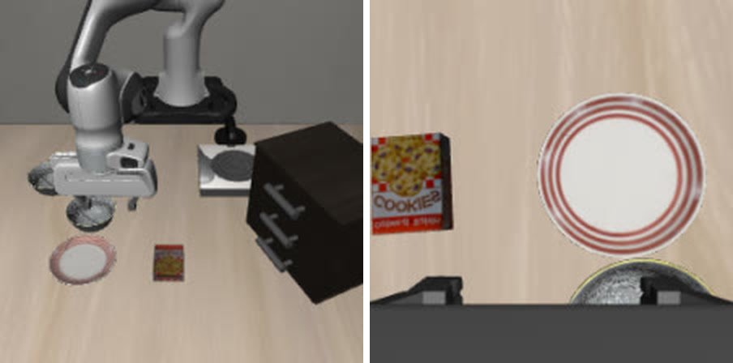
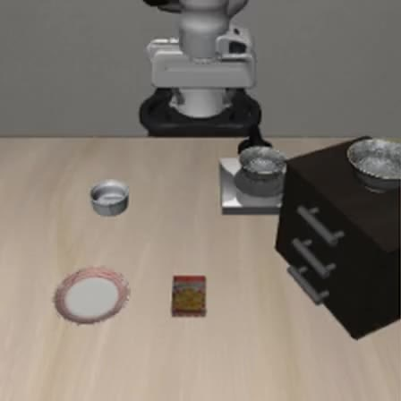
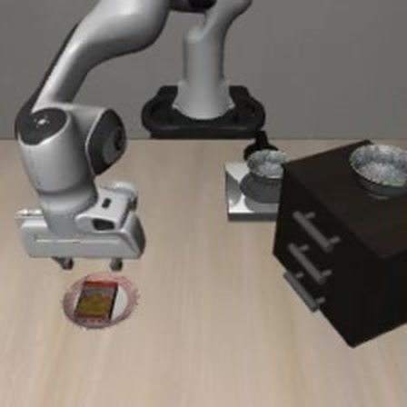
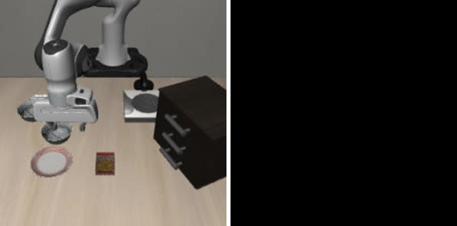
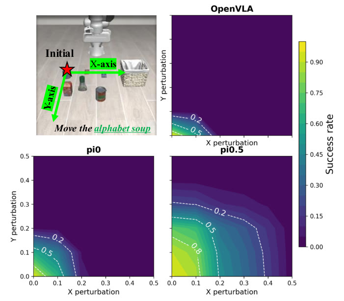
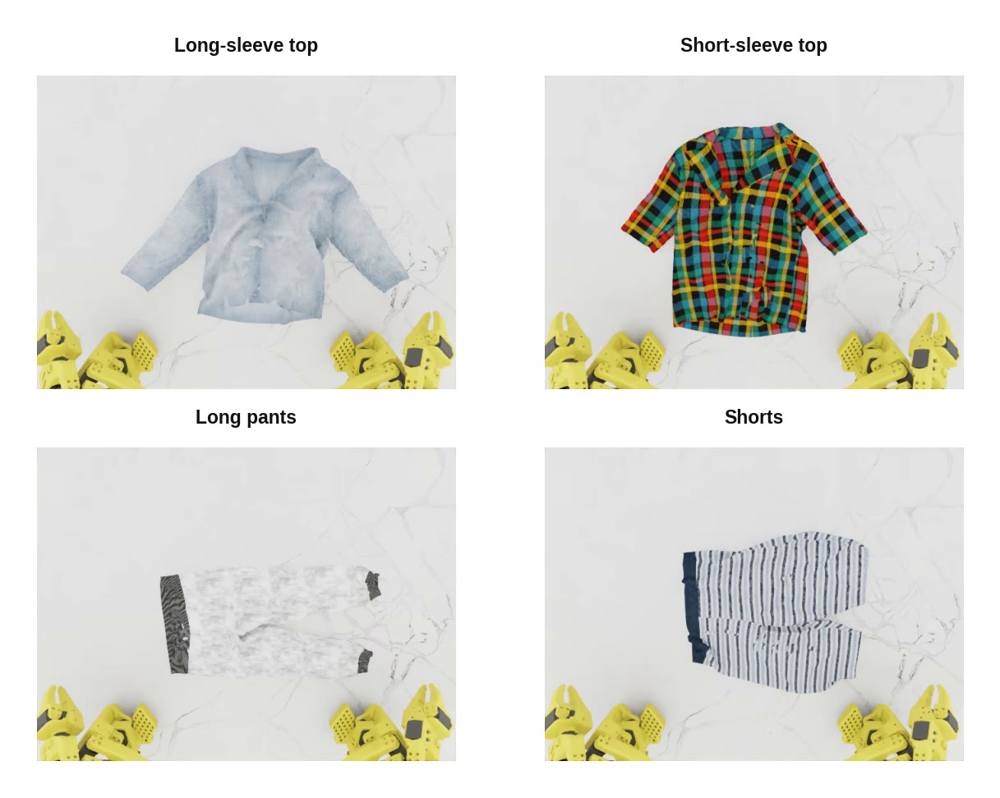
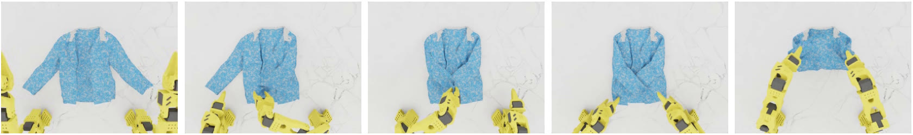

# Progress

This page is a short summary for our presentation. The detailed plan and our records are in
[`topic.md`](topic.md) and [`stage1/`](stage1/README.md).

## The question

When a robot is told "put the bowl on the plate" and does it, did it read the sentence? Or did it just recognise the
table and do the job it learned there? We're testing π0.5, an open robot model from Physical Intelligence, to find
out what it really goes by: the words, what its cameras show, or where things sat when it was trained. Each test
changes one of these the way a real home might, and we compare how often the robot succeeds before and after.

| Stage | Dates | What we ask | Status |
|---|---|---|---|
| 1. Get it running | Nov 7–14 | Set up π0.5 in a simulated kitchen and test whether it follows the words | done |
| 2. What it goes by in the kitchen | Nov 15–Dec 2 | Change the words, the cameras and where things sit, one at a time | now |
| 3. Laundry | Nov 24–Dec 9 | Ask the same questions of a robot folding clothes | next |

We write everything up from Dec 10 to 13. Each test gets a short page with what we guessed beforehand, the videos side
by side, the success rate, and what it would mean for a robot in a real home.

## Stage 1: Get it running (done)

We built the whole setup on our own desktop. π0.5 runs on the graphics card, in the exact version Physical
Intelligence trained and published for LIBERO, a simulated kitchen with a robot arm. The kitchen runs next to it in
the MuJoCo physics simulator, with the same software versions used for the official scores, so our numbers can be
compared with theirs. While the arm works, the simulator sends the model two pictures, one from a camera facing the
table and one from a camera on the robot's hand, together with the instruction. That's all the model gets. It answers
with the arm's next few movements, the arm makes them, and then the model looks again.

*Figure 1. What the model sees, from our own run. The left picture comes from the camera facing the table and the
right one from the camera on the robot's hand, as the gripper comes down over a bowl. These two pictures and the
instruction are everything the model gets.*

On top of this we wrote our own test runner. It runs any LIBERO task with any instruction we choose, including none at
all. While each try runs, it checks what the robot actually did, such as which object ended up on the plate, and it
films both cameras side by side. We also recorded one full task step by step, so we can show exactly what goes into
the model and what comes out.

Our first test uses two tasks that start from the same table, with two identical black bowls, one on the stove and
one on top of a wooden cabinet. Only the words say which bowl goes on the plate. With the instruction, the robot took
the right bowl 19 times out of 20. With the instruction erased, it succeeded only 8 times out of 40, and it often put
the wrong thing on the plate, such as the other bowl or a cookie box. So on this table, the robot really does read the
words.

  
  

*Figure 2 (left). The table that both first-test tasks start from. The black bowl on the stove and the one on top of
the cabinet are identical, so only the words say which one to take. Figure 3 (right). One ending with the instruction
erased. The robot put the cookie box on the plate, which no task asked for.*

## Stage 2: What it goes by in the kitchen (now)

In the same kitchen we change one thing at a time and see how often the robot still succeeds. First we run the
official test to confirm our setup matches the score Physical Intelligence published.

**The words.**
- Across whole sets of tasks, we erase the instruction or swap in the sentence from a different task, and compare with
  numbers another group published for this model.
- We reword the instruction the way a person might say it, say it in Chinese, or add a typo.
- Whenever the robot does a task we didn't ask for, we note which one, for example whether it turns on the stove.

**What it sees.**
- We black out one camera, first the one on the hand and then the one facing the table, to see which one it can do
  without (Figure 4).
- We move the table camera a little at a time, as if someone bumped it, to see how far it can go before the robot
  gets lost.
- We move one object to a new spot. If the plate moves, does the bowl go to the plate, or to where the plate used to
  be? (Figure 5)
- We let the model think less before each move, as it would have to on a cheaper computer.

  
  

*Figure 4 (left). What the model would get with its hand camera blacked out: the table picture and a black square.
Figure 5 (right). A published result we build on (LIBERO-PRO, Figure 4). The farther an object starts from its usual
spot, the less often π0.5 succeeds. Our test asks the same question in our kitchen.*

## Stage 3: Laundry (next)

Laundry is one of the chores home robots are now being sold for. Here we move to a simulator where two robot arms fold
long-sleeve tops, short-sleeve tops, long pants and shorts (Figure 6). The model is also built on π0.5. It came first
of 62 teams in the online round of the 2026 LeHome folding competition, folding 79.63% of garments in the simulator
(Figure 7). This simulator needs a bigger graphics card than ours, so we run it on a rented one. Then we ask the same
kinds of questions: we tell it the wrong garment, give it a garment it has never seen, and cover one of its three
cameras.

*Figure 6. The four garments in the laundry simulator, seen from the overhead camera (from the winning team's report).*

*Figure 7. The winning model folding a long-sleeve top in the simulator, from start to finish in 9.9 seconds (from the
same report).*

## Picture credits

- Figures 1–3: our own runs of `pi05_libero` in LIBERO. Figure 4 is our illustration of the test, made from Figure 1's
  table picture with a black square for the hand camera.
- Figure 5: Zhou et al. (2025), LIBERO-PRO, Figure 4, CC BY 4.0, https://arxiv.org/abs/2510.03827
- Figures 6 and 7: Larchenko (2026), Learning to Fold: prizewinning solution at LeHome Challenge 2026, Figure 1 and the
  top row of Figure 7 (cropped), CC BY 4.0, https://arxiv.org/abs/2606.27163
